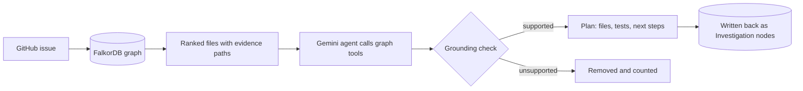
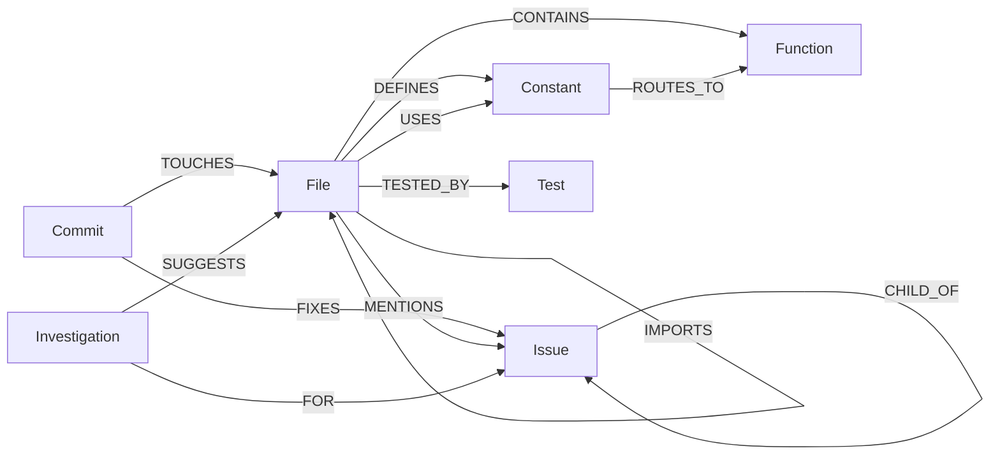

# RepoGraph AI

**An evidence-backed issue investigation prototype for the Oppia codebase, built on FalkorDB.**

Give it an Oppia issue. It walks a graph of Oppia's git history, GitHub issues and backend code, and returns the files to look at first, the tests to run, and **the graph path behind every recommendation**. When the graph has no evidence, it says so instead of guessing.

[](https://github.com/alok844937-design/repograph-ai/actions/workflows/tests.yml)

- **Live demo:** https://repograph-ai-cinoibbc8myjvoe8si5tk9.streamlit.app/
- **Demo video:** https://youtu.be/FjhqzvyKOs0
- Built for **Graph Hacks** (WeMakeDevs x FalkorDB), track 1: *Agents That Act on Connected Data*.

> This is a prototype. It covers Oppia's **backend Python code only**, and the measured gain over keyword search is modest. Both points are explained below.

---

## Results at a glance

| | Keyword search (graph off) | Keyword + graph (graph on) |
|---|---|---|
| 21 hand-grouped held-out issues, hit@5 | 14/21 | 14/21 |
| 29 more issues picked by a rule committed before running, hit@5 | 18/29 (62%) | **20/29 (69%)** |

- On the 29-issue set, the **gated** method (adds the graph only when it has direct evidence) turned **1 miss into a hit and 0 hits into misses**.
- Biggest single win: issue [#24156](https://github.com/oppia/oppia/issues/24156). Keyword search ranks the fixed file **28th**; with the graph it is **5th**, because a sibling issue's fix had already changed it.
- The triage agent wrote **23 plans** for open issues: 5 high, 1 medium and 17 low confidence. On 14 of the 20 newest open issues (frontend, CI and acceptance tests, outside the backend graph) it declined to name files.
- The grounding check removed **24 file suggestions** the agent made without tool evidence. High-confidence plans contained none.

---

## How it works



1. **Build the graph** from Oppia's git history (since 2022), issue texts and parent links from the GitHub API, and the backend code parsed with Python's `ast`.
2. **Investigate** an issue. Direct evidence comes first: the issue names a file, a `TODO(#issue)` comment, or a parent or sibling issue whose fix changed a file. Expansion along imports, routes and co-changes can reorder files, but is capped so it never outranks direct evidence.
3. **Agent** (Gemini): it reads the investigation, calls graph tools (`related_issues`, `file_context`, `keyword_search`) and writes a plan. Any file or test it names that no tool returned is removed.
4. **Act**: the triage agent runs on open issues and writes each plan back into the graph as `(:Investigation)-[:SUGGESTS]->(:File)`. The investigation never reads these nodes, so an agent's output can never become evidence for itself.

**No leakage by design.** For an already fixed issue, only commits from before its fix are visible, and issue comments are never loaded (they often name the fix). Keyword search runs on the code as it was just before the fix.

---

## The graph

About **25,700 nodes and 39,000 edges**: 3,239 commits, 825 files, 19,426 functions, 655 constants, 339 tests and 1,216 issues.



### Where each edge comes from, and how far to trust it

Every edge stores a `provenance` property. An edge records a link; **it does not prove two files are related in meaning**. The UI shows each piece of evidence with its tier, source and caveat.

| Edge | Provenance | Source | Reliability |
|---|---|---|---|
| `FIXES` | `git_commit` | `Fix #N` in a commit subject | High, but only as good as the commit message |
| `TOUCHES` | `git_commit` | `git log --name-only` | High |
| `CHILD_OF` | `github_parent` | GitHub sub-issue API | High |
| `MENTIONS` | `todo_comment` | `TODO(#N)` in code | High: a developer wrote it |
| `IMPORTS` | `python_ast` | import statements | High that the import exists; says nothing about relevance |
| `IMPORTS` | `registry_mapping` | Oppia's `Registry.import_*()` methods, read from `core/platform/models.py` | Medium: derived from a mapping, not a direct import |
| `CONTAINS`, `DEFINES`, `USES` | `python_ast` | parsed code | High |
| `ROUTES_TO` | `route_table` | routes parsed from `main.py` | Medium-high |
| `TESTED_BY` | `test_import` / `naming_convention` | test imports the module / `foo.py` ↔ `foo_test.py` | High / medium |
| `SUGGESTS` | `agent` | the triage agent's plan | A suggestion only; never used as evidence |

Evidence tiers in the app: 🟢 **direct** (issue text, TODO comment) · 🟡 **related** (parent or sibling issue fix) · 🔵 **structural** (imports, routes) · ⚪ **weak** (co-change, shared title words).

---

## Key Cypher queries

Files changed by the fix of this issue's **parent**, using only history from before the cutoff:

```cypher
MATCH (:Issue {number: $n})-[:CHILD_OF]->(p:Issue)
      <-[:FIXES]-(c:Commit)-[:TOUCHES]->(f:File)
WHERE c.date < $cutoff
RETURN p.number, c.sha, c.date, f.path
```

Files changed by fixes of **sibling** issues (same parent):

```cypher
MATCH (:Issue {number: $n})-[:CHILD_OF]->(:Issue)<-[:CHILD_OF]-(s:Issue)
      <-[:FIXES]-(c:Commit)-[:TOUCHES]->(f:File)
WHERE c.date < $cutoff AND s.number <> $n
RETURN s.number, c.sha, c.date, f.path
```

Expansion from a strongly supported file along **one or two imports**, keeping the provenance of every hop:

```cypher
MATCH p = (:File {path: $s})-[:IMPORTS*1..2]->(f:File)
WITH f, length(p) AS hops, [e IN relationships(p) | e.provenance] AS provenance
MATCH (f)<-[:IMPORTS]-(importer:File)
RETURN f.path, provenance, hops, count(DISTINCT importer)
```

From a file to the **request handler** its URL constant routes to:

```cypher
MATCH (:File {path: $s})-[:USES]->(c:Constant)-[:ROUTES_TO]->(fn:Function)
RETURN c.name, fn.path
```

The **triage board**: the agent's plans, read back from the graph:

```cypher
MATCH (r:Investigation)-[:FOR]->(i:Issue)
OPTIONAL MATCH (r)-[s:SUGGESTS]->(f:File)
WITH r, i, s, f ORDER BY s.rank
RETURN i.number, i.title, r.confidence, collect(f.path)
```

---

## One issue end to end: #25307

[#25307](https://github.com/oppia/oppia/issues/25307) asks for email retries to stop on 4xx errors. The issue text names no file.

- **Evidence path:** `#25307 -CHILD_OF-> #18276 <-FIXES- commit 2405253 -TOUCHES-> core/controllers/tasks.py`, plus an independent path: `tasks.py` carries a `TODO(#25307)` comment.
- **Ranking:** `core/controllers/tasks.py` is ranked **1st**, from history before the fix.
- **Real fix:** changed `core/controllers/tasks.py`, `core/domain/email_services.py` and `core/platform/email/mailgun_email_services.py`.
- **Test to run first:** `python -m scripts.run_backend_tests --test_target=core.controllers.tasks_test`

**A failure:** for [#18371](https://github.com/oppia/oppia/issues/18371), keyword search ranks the fixed file 3rd, but adding the graph pushes it to 22nd. Graph evidence pointed at the wrong area. For [#24470](https://github.com/oppia/oppia/issues/24470), every method misses.

**An "unknown":** for [#27619](https://github.com/oppia/oppia/issues/27619), an acceptance-test failure in TypeScript, the graph has no evidence; the agent searched, found nothing it could support, and returned a low-confidence plan with no files.

---

## Evaluation

**Task:** given an issue, rank backend files. **Answer (labels):** the non-test backend files changed by the commits that fixed it.

**Metrics:** *hit@5* means at least one fixed file is in the top 5. *recall@5* is the share of fixed files that are in the top 5.

**Methods:**
- `keyword`: BM25 over the code just before the fix, after any file the issue names directly.
- `graph`: the graph investigation alone.
- `graph + keyword`: keyword scores scaled and added to the graph score.
- `graph + keyword (gated)`: adds the graph only when its top score is at least `SEED_THRESHOLD` (an existing constant), otherwise plain keyword search.

**Two sets:**
1. **21 held-out issues**, grouped by how much the text reveals (stack trace names the fixed file, names a different file, no file, file named without a trace). Weights were frozen before these were scored. One bug in how `graph + keyword` scaled keyword scores was found on a first run and fixed (it had pushed #18371's fixed file to rank 51); nothing else changed after scoring. Full table: [`results/evaluation.md`](results/evaluation.md).
2. **29 more issues**, selected by a rule committed to git *before* the script was first run: every issue first fixed on or after 2025-01-01 whose fix changed a non-test backend file, minus the held-out and development issues. Full table: [`results/evaluation_large.md`](results/evaluation_large.md).

| Held-out (21) | hit@5 | recall@5 |
|---|---|---|
| keyword | 14/21 | 63% |
| graph | 12/21 | 48% |
| graph + keyword | 14/21 | 61% |

| Rule-selected (29) | hit@5 | recall@5 |
|---|---|---|
| keyword | 18/29 (62%) | 41% |
| graph | 12/29 (41%) | 24% |
| graph + keyword | 20/29 (69%) | 41% |
| graph + keyword (gated) | 19/29 (66%) | 41% |

**What this shows:** keyword search is a strong baseline. The graph alone is weaker; it helps most when it has direct evidence, and it adds an evidence path to every recommendation. Re-running the evaluation after the triage agent wrote its plans into the graph gives identical results.

**What it does not show:** that abstention never hides a relevant file. That has not been measured yet. The sets are small, so differences of one or two issues should not be over-read.

### Reproduce

```bash
python -m repograph.evaluate                       # 21 held-out issues
python -m repograph.evaluate_large --limit 2000    # rule-selected issues
python -m repograph.export_dataset                 # frozen dataset
```

[`data/evaluation_dataset.json`](data/evaluation_dataset.json) holds every evaluated issue with its frozen text, fix commit, the revision keyword search ran on, and the file labels. The evaluation can be checked without the graph or the GitHub API.

---

## Setup

Requirements: **Python 3.12+** (Oppia's code uses PEP 701 f-strings), git, and a FalkorDB instance ([FalkorDB Cloud](https://app.falkordb.cloud) free tier, or Docker).

```bash
git clone https://github.com/alok844937-design/repograph-ai.git
cd repograph-ai
python3.12 -m venv venv && source venv/bin/activate
pip install -r requirements.txt
cp .env.example .env        # fill in the values
```

FalkorDB locally:

```bash
docker run -p 6379:6379 -it --rm falkordb/falkordb
```

`.env` keys: `FALKOR_HOST`, `FALKOR_PORT`, `FALKOR_USERNAME`, `FALKOR_PASSWORD`, `OPPIA_REPO` (path to an Oppia clone with an `upstream` remote), `GITHUB_TOKEN` (read-only, for issue texts), `GEMINI_API_KEY` (optional).

Build the graph and check the setup:

```bash
git clone https://github.com/oppia/oppia.git ../oppia
git -C ../oppia remote add upstream https://github.com/oppia/oppia.git
git -C ../oppia fetch upstream

python -m repograph.build           # git history, code, issues
python -m repograph.ingest_open     # optional: open issues for triage
python -m repograph.smoke           # connection, graph contents, one known issue
python -m pytest -q                 # unit tests, no database needed
```

### Use

```bash
streamlit run app.py                         # web app
python -m repograph.investigate 25307        # graph investigation
python -m repograph.agent 25307              # agent plan, saved to reports/
python -m repograph.triage --limit 10        # plan open issues, write to the graph
python -m repograph.triage --limit 10 --no-llm   # graph-only plans, no API calls
```

---

## Security model

- **Read-only by default.** The agent's tools run read-only queries (`ro_query`). Every Cypher query is parameterised; issue text and model output are passed as parameters, never concatenated into a query.
- **No arbitrary execution.** The agent can only call three fixed tools. Git is called with an argument list, never through a shell, and the revision comes from the graph, not from the model.
- **Writes are explicit.** Only the triage command and a button in the local app write to the graph, and the button is off unless `ALLOW_WRITES=1`. The public demo cannot write.
- **Nothing is posted to GitHub.** Plans are for a human to read.
- **Prompt injection.** An issue could try to steer the model. The worst outcome is a wrong suggestion; any file the tools did not return is removed by the grounding check, and the model has no tool that writes or executes.

## Cost and latency

| Step | Measured |
|---|---|
| Graph investigation (#25307) | about 3 s |
| Agent plan (#27595, with Gemini) | 6 min 33 s, mostly Gemini retries under high load |
| Graph-only plan (`--no-llm`) | no API calls, same speed as the investigation |

The agent makes at most 7 model calls per issue and uses Gemini Flash models. If every model fails, it falls back to a graph-only plan instead of failing.

## Maintainability

| Module | Job |
|---|---|
| `ingest_git.py`, `ingest_code.py`, `ingest_issues.py`, `ingest_open.py` | build the graph |
| `investigate.py` | evidence and ranking |
| `baseline.py` | keyword search |
| `agent.py`, `llm.py`, `triage.py` | agent, grounding, write-back |
| `evaluate.py`, `evaluate_large.py`, `export_dataset.py` | evaluation and dataset |
| `app.py`, `viz.py` | web app and evidence graph |
| `smoke.py`, `tests/` | setup check and unit tests (CI on every push) |

If the schema changes, the ingestion and the queries in `investigate.py` change together; `smoke.py` and the evaluation catch breakage. Schema versioning is on the roadmap.

---

## Limitations

- **Backend Python only.** Most of Oppia's recent fixes are in the TypeScript frontend; 121 of the first 150 issues the rule considered had no backend change. Frontend, CI and acceptance-test issues get "unknown".
- **Small evaluation.** 50 issues in total. The gain is real but modest.
- **History depends on commit messages.** Fixes that do not say `Fix #N` are invisible.
- **An edge is not proof of meaning.** Imports and co-changes link files that may be unrelated to a given bug; they are shown as structural or weak evidence.
- **The agent depends on Gemini** availability and can be slow under load.
- The free FalkorDB tier sleeps when idle; a GitHub Action queries it twice a day to keep the demo up.

## Roadmap

- **P0:** measure abstention (how often "unknown" hides a relevant file); verify more recommendations against later fixes.
- **P1:** a TypeScript import graph for the frontend; a CI graph linking failing tests to workflows.
- **P2:** schema versioning and incremental graph updates.

---

## Preparation and AI use

Before October 15, I prepared planning notes and a rough graph schema sketch for RepoGraph AI. I did not write any project code before the hackathon began; the implementation was developed during the hackathon.
During development, I used Claude (Anthropic) as an assistant for coding, debugging, exploring implementation approaches, reviewing explanations, and improving documentation. I treated AI-generated suggestions as drafts that needed to be checked rather than automatically assuming they were correct. Separately, Gemini is part of the product itself: it powers the investigation agent at runtime.
I made and reviewed the project's design and evaluation decisions, examined the benchmark results, and investigated cases where graph-based ranking failed to improve on keyword search. I also worked on evidence provenance, temporal leakage prevention, and grounding checks to make the system's recommendations more transparent and verifiable.

AI-assisted development contributed to the implementation, but I remain responsible for reviewing the code, checking the results, and accurately reporting the project's capabilities and limitations.

## License

MIT
